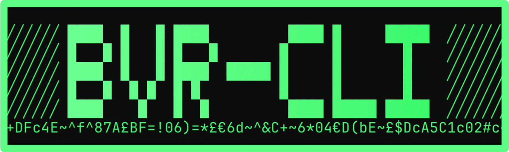
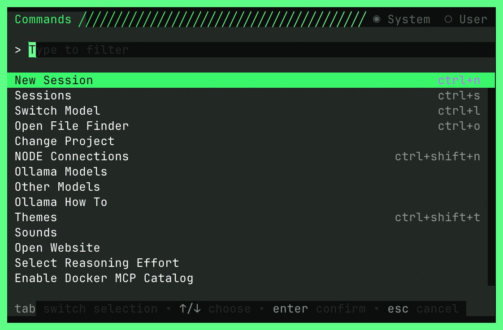
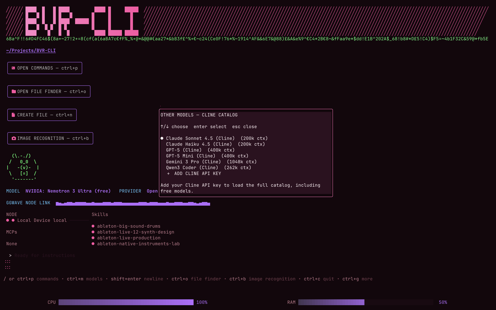

# BVR-CLI 1.2.9


###### an APP BY RICHARD AIZEN AVERY.
###### dedicated to THE BEAV.

## **BVR-CLI is a KEYBOARD-FIRST AI workspace for the terminal. Great for beginners and professionals alike!**

**This app is for those who want total control over their CLI app of choice; with lots of menu options and plenty of themes for those who like to customize their setups!

BVR-CLI brings conversations, project files, local models, tools, permissions, skills, LSP, MCP, audio feedback, and multi-device NODE work into one fast CLI/TUI cockpit.

### __ABOUT:__ **"BVR"="BEAVER"**  
**Why BVR-CLI?**

I built this app because I wanted a tool that looked and acted like me: bright, loud, fast, and relentlessly dynamic.

Most developer tools on the market are either painfully boring or too narrowly focused to be genuinely fun. So, I took the best elements from my absolute favorite apps, threw out the rulebook, and baked them into a single, high-performance command-line environment built for custom, high-end rigs.
The Aesthetic & Theme

I spent a long time dialing in the color scheme and visual architecture. It needed to feel alive, heavily customized, and right at home on my machines—pushing a high-contrast palette of neon greens, hot pinks, and electric purples across a dark charcoal base.

**Dedicated to "The Beav"**

This app is named after one of the smartest, funniest, and most honorable human beings I’ve ever known. His friends and family call him "the Beav" (aka "Beaver"), and I am dedicating this work entirely to him.

This is my way of saying thank you for everything he has contributed to my family and my own life. Life would be significantly more boring without him around, and this project serves as a daily reminder that we’re all lucky to be here—and insanely lucky to have someone as awesome as the Beav in our corner.

**Support & Status**

As of November 2026, BVR-CLI has officially entered its BETA phase. It’s available for public use right here on GitHub for anyone who wants a little more attitude and power out of their command-line interface.

If you'd like to support the project, any donations or contributions will go directly toward keeping it alive, active, and accessible to the public.

**DONATIONS:**<br>


click for email:
[GMAIL](mailto:averydevz@gmail.com) or
[OUTLOOK](mailto:averydevz@outlook.com)<br>


## Why BVR-CLI?

AI development usually means bouncing between a terminal, model picker, file browser, editor, browser, notification system, and a pile of helper scripts.
BVR-CLI is designed to make that whole loop feel like one application:

1. Open a project.


2. Choose a provider or local model.

3. Ask for work in the chat editor.

4. Review tool calls, permissions, files, and output in one place.

5. Continue from another device through the NODE architecture.

 

#### It is friendly enough for someone new to AI tools, while keeping the keyboard
shortcuts and escape hatches experienced developers expect.


## Quick start

Build and run the current checkout:

```sh
git clone https://github.com/rfaiii/BVR-CLI.git
cd BVR-CLI
go run .
```

Or install the local build:

```sh
./scripts/install-bvr-cli.sh
bvr-cli --version
bvr-cli --help
```

Start in a specific project:

```sh
bvr-cli --cwd /path/to/project
```

For packaged macOS, Windows, and Linux installation paths, see
[`docs/SETUP.md`](docs/SETUP.md).

## Feature set

### AI workspace

- Provider and model selection with model warm-up feedback
- Local Ollama discovery, pull, startup, and runtime status
- Streaming conversations with sessions and prompt history
- Permission and question flows that keep tool execution visible
- Agent Skills discovery, status, and project-aware workflows
- MCP servers, prompts, resources, and authentication flows
- LSP status and project diagnostics

### Project cockpit

- Project-aware File Finder with previews, metadata, hidden files, paging,
  clipboard support, and project switching
- Create-file flow from the homescreen and command menu
- Embedded web browser for research without leaving the TUI
- Shell/bang mode for quick command execution with streamed output
- Attach files, images, videos, links, and project resources from the editor
- Persistent project registration and recently accessed projects

### TUI and interaction design

- Keyboard-first controls with mouse support where it helps
- Animated Beaver identity mark and animated GGWave node-link visualization
- Responsive compact and wide layouts
- Gradient branding, status indicators, cursor effects, and resource meters
- Audio cues for startup, menus, prompt submission, chat responses, loading,
  permissions, errors, navigation, and long-running work
- Configurable notification style and safe audio volume controls (25/50/75/100% or silent)

### Nodes and multi-device work

BVR's NODE layer is intended for using the same workspace from multiple
devices. The project already contains HTTP/JSON, WebSocket, and SSH transport
designs, with a portable pairing envelope and a GGWave-inspired visual pairing
surface in the TUI. The native GGWave audio codec adapter is being kept
optional so the default cross-platform build remains CGO-free.

See [`docs/NODES.md`](docs/NODES.md) and [`docs/MOBILE.md`](docs/MOBILE.md).

## Useful controls



| Action | Shortcut |
| --- | --- |
| Command menu | `Ctrl+P` |
| File Finder | `Ctrl+O` |
| Image Recognition | `Ctrl+B` |
| Models | `Ctrl+L` |
| Sessions | `Ctrl+S` |
| NODE settings | `Ctrl+Shift+N` |
| Themes | `Ctrl+Shift+T` |
| Beast Mode | `Ctrl+Y` |
| Help | `Ctrl+G` |
| Cancel/close | `Esc` |

The exact keymap is configurable and the command menu is the best place to
discover the complete action set.

## Development

BVR's release builds intentionally use a CGO-disabled toolchain for portable
cross-compilation.

```sh
gofmt -w .
go test ./...
go vet ./...
go build ./...
```

Package the supported targets with:

```sh
./scripts/package/build-all.sh 1.2.9
```

## Documentation

| Document | Purpose |
| --- | --- |
| [`docs/README.md`](docs/README.md) | Documentation index and conventions |
| [`docs/SETUP.md`](docs/SETUP.md) | Installation, dependencies, and troubleshooting |
| [`docs/PROVIDERS.md`](docs/PROVIDERS.md) | Ollama local models and the Cline gateway |
| [`docs/UI.md`](docs/UI.md) | Branding, mascot, File Finder, command palette, dialogs |
| [`docs/NODES.md`](docs/NODES.md) | Multi-device transports and GGWave pairing |
| [`docs/MOBILE.md`](docs/MOBILE.md) | Mobile companion apps and host-side bridge |
| [`docs/ARCHITECTURE.md`](docs/ARCHITECTURE.md) | System boundaries and roadmap |
| [`docs/FEATURES.md`](docs/FEATURES.md) | Full feature inventory and contact info |
| [`docs/SKILLS.md`](docs/SKILLS.md) | Agent Skills discovery and syncing |
| [`docs/PACKAGING.md`](docs/PACKAGING.md) | Installer, distribution, and asset reference |
| [`docs/BETA.md`](docs/BETA.md) | Beta testing and release process |
| [`docs/TASKLIST.md`](docs/TASKLIST.md) | Performance and optimization work plan |



## Beta feedback

When reporting an issue, include:

1. Operating system and CPU architecture
2. Terminal application
3. `bvr-cli --version` output
4. Launch command and project path
5. Provider/model configuration, if relevant
6. Reproduction steps and terminal output

Open an issue at [github.com/rfaiii/BVR-CLI](https://github.com/rfaiii/BVR-CLI/issues).

## License

BVR-CLI is released under the Functional Source License, Version 1.1, MIT Future
License (FSL-1.1-MIT). See [LICENSE.md](LICENSE.md).

**One terminal. Every project. A little more beaver.**

###### Contact: <averydevz@gmail.com> & <averydevz@outlook.com>