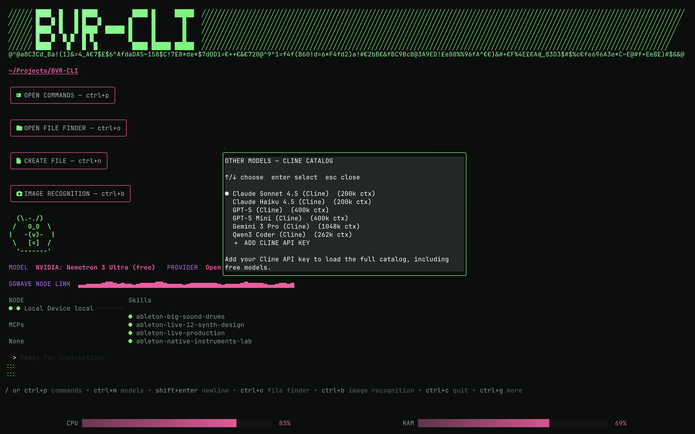

# BVR-CLI UI Guide

This document is the consolidated reference for the TUI: branding and the
wordmark, the animated Beaver mascot, the File Finder, the command palette,
and dialog behavior. It merges the former `UI_BRANDING.md`,
`BEAVER_MASCOT.md`, `FILE_FINDER.md`, and `COMMAND-MENU.md`.

## Branding and wordmark

### Wordmark source of truth

The display name is `logo.Wordmark` in `internal/ui/logo/logo.go`. Use
`scripts/set-wordmark.sh` to change it:

```bash
./scripts/set-wordmark.sh BVR-CLI
```

The script validates the name and updates the shared constant used by the
compact header, sidebar, and custom wide banner.

### Wide banner font

The wide banner does not use the original BVR letterform list. Its glyphs are
defined in `bvrCLIASCII`, a five-row map of block-character strings. The
renderer assembles those glyphs with `renderASCIIWordmark`, applies the theme's
title gradient, and places the result between the diagonal side fields.

To change a letter, edit that letter's five strings in `bvrCLIASCII`. Keep all
five rows the same display width so the banner remains aligned. Add a new map
entry before using a character in `Wordmark`.

### Persistent prompt-style animation

The strip below the banner reuses `internal/ui/anim.Anim`, the same component
used by the `Generating` prompt spinner and assistant thinking indicators. The
banner creates one animation with ID `bvr-banner`, cycling characters, and the
theme logo gradient. `UI.Init` starts its 20 FPS `StepMsg` chain; the main UI
`Update` loop forwards matching ticks to the animation, and `renderLogo` passes
`bannerAnim.Render()` to the logo package.

The strip is intentionally rendered below the banner with no blank row. Its
width is truncated to the current terminal width by the logo renderer. Adjust
the animation's `Size`, colors, or `CycleColors` settings in `UI.New` if a
different density or palette is desired.

## Beaver mascot

The Beaver is a terminal-native mascot system designed around fixed-width
frames, so animation never moves the surrounding TUI.

### One mascot, two screens

As of **1.2.8 the homescreen and the working screen show the same animated
BVR**. There is no longer a separate "hero" beaver and "sidebar" beaver.

| Screen | Renderer | Footprint |
| --- | --- | --- |
| Homescreen / landing | `anim.BeaverFrame(key, errored)` | 13×5 |
| Working screen / sidebar | `anim.BeaverFrame(key, errored)` | 13×5 |

Both call `(*UI).beaverFrameKey()` in `internal/ui/model/ui.go`, which is the
single source of truth for pose selection. This guarantees the two screens can
never drift apart: same priority order, same reactions, same mouse tracking.
`TestBeaverFrameSharedAcrossScreens` asserts byte-identical output across every
frame key.

### What changed in 1.2.8

Before this release the sidebar used `MiniMascotFrame` — a 12×7 mascot with a
*different, reduced* expression set (center, look-left/right/up/down, laugh,
shocked, dance, chomp, click-boop, music). That path is gone from the TUI. The
helpers `MiniMascotFrame` and `LargeMascotFrame` remain in `internal/ui/anim`
and are still covered by `anim_test.go`, but nothing in the UI renders them.

`LargeMascotFrame` is still used by `version_banner.go` for `--version`.

### Render sizes

- **Dense (homescreen and sidebar):** 13×5 cells — the plain-ASCII beaver from
  `boot.BeaverFramesDenseAlpha` / `boot.BeaverFramesDenseBeta`, with 6 frame
  keys: `center` (resting), `left-dir`, `right-dir` (driven by mouse gaze OR
  keys/selected text left/right of center), `what` (beaver clicked), `error`
  (agent error), and `confused` (agent loading/thinking).
- **Large (legacy):** 24×8 via `LargeMascotFrame`, used only by the version
  banner and the anim footprint tests.

The Alpha map holds the normal-expression frames (center, left-dir, right-dir,
what); the Beta map holds the x-ray expressions (error, confused). The boot
demo (`boot.Run`) cycles through the full frame set, so every expression is
shown during startup.

### ASCII art design

The dense beaver head is a compact 7-cell pattern: `(\.-.\\)` — the backslash
for the right ear (`\\)` instead of a closing parenthesis `)`) connects the ear
visually to the head, creating a continuous line from the top of the head down
the right side. This design choice ensures the ears appear attached at all
font renderings and terminal sizes. The single dash `.-.` on top keeps the
head silhouette clean while providing enough width for both ears to sit
symmetrically.

### Frame lookup across the Alpha and Beta maps

The two maps hold **disjoint** poses, so `BeaverFrame` consults both:

- When `errored` is true the Beta (x-ray) map wins, then Alpha.
- When `errored` is false the Alpha map wins, then Beta.
- Only if neither map has the key does it fall back to Alpha `center`.

This matters. An earlier version searched a single map based on `errored`,
which made `confused` and `error` unreachable whenever `errored` was false — the
agent-busy expression silently rendered as the resting face.
`TestBeaverFrameEveryKeyResolves` and
`TestBeaverFrameConfusedRendersWhenNotErrored` guard this.

### Behavior

Mouse motion maps to five gaze buckets: center, left, right, up, and down. A
dead zone around the face prevents twitching. When the pointer is clearly left
or right of the mascot, the beaver looks left/right to follow it; over the
mascot it returns to the idle "rest" pose.

Gaze resolves against **whichever mascot is on screen**: `beaverRect` on the
homescreen, `sidebarBeaverRect` on the working screen. Both go through
`(*UI).visibleBeaverRect()`.

Clicking the mascot's hitbox randomly plays one of six Beaver cues
(`WHAT-FLAT.wav` or `OH-BEAV-01.wav` through `OH-BEAV-05.wav`) and briefly
shows the `what` reaction for 650 ms. This works on both screens. The hitbox is
sized from the exact frame string that was composed into the logo
(`sidebarBeaverFrame`), so it always matches the art on screen, and it is
**cleared when the sidebar is too short to draw the mascot** so clicks in empty
space cannot boop an invisible mascot.

Keys and selected text still drive direction too: text typed left/right of the
prompt center makes the beaver look left/right, and any cursor-moving key
(arrow keys, Home/End, typing) updates the direction.

### The six frame functions

| Frame key  | Shown when...                                                    |
|------------|------------------------------------------------------------------|
| `center`   | Resting — the neutral idle pose.                                   |
| `left-dir` | Mouse or text is to the LEFT of center (mouse follows; typing, arrows, Home/End). |
| `right-dir`| Mouse or text is to the RIGHT of center (mouse follows; typing, arrows, Home/End). |
| `what`     | The user clicked the beaver mascot (650 ms reaction + SFX).      |
| `error`    | The agent errored (`notify.TypeAgentError`).                     |
| `confused` | The agent is loading or thinking (`isAgentBusy()`).              |

Priority order, identical on both screens:

```
error > what (recent click) > confused (thinking)
  > mouse-dir (pointer clearly left/right of mascot)
  > resting (idle pulse)
  > keyboard-dir (text/cursor left/right of center)
  > center
```

### Implementation

- `internal/ui/anim/beaver.go` — `BeaverFrame(key, errored)` plus
  `lookupBeaverFrame`, `normalizeDenseFrame` (keeps every pose at 13×5),
  `DenseFrameWidth` / `DenseFrameHeight`, and `FrameFromDir(dir int)`
  for mouse/keyboard direction frames.
- `internal/ui/boot/boot.go` — `BeaverFramesDenseAlpha` (center, left-dir,
  right-dir, what), `BeaverFramesDenseBeta` (error, confused), and
  `BootSequence`.
- `internal/ui/model/ui.go` — `beaverFrameKey()` (shared pose resolver),
  `beaverFrame()`, `visibleBeaverRect()`, beaver state fields,
  `triggerBeaverBoop()` SFX, `beaverMouseDir()`, `handleAgentNotification`,
  and `cacheSidebarLogo()` which renders the sidebar mascot into
  `sidebarBeaverFrame`.
- `internal/ui/model/landing.go` — homescreen hero, now just
  `m.beaverFrame()` plus hitbox layout.
- `internal/ui/model/sidebar.go` — sizes `sidebarBeaverRect` from the cached
  frame and clears it when the mascot is not drawn.

### Tests

`internal/ui/model/ui_test.go`:
`TestBeaverFrameSharedAcrossScreens`, `TestSidebarBeaverFrameUsesDenseMascot`,
`TestVisibleBeaverRectFollowsState`, `TestBeaverClickBoop`,
`TestBeaverMouseDir`, `TestBeaverMouseGazeFromMotion`.

`internal/ui/anim/anim_test.go`:
`TestBeaverFrameEveryKeyResolves`, `TestBeaverFrameConfusedRendersWhenNotErrored`,
`TestBeaverFrameErrorTakesPriorityWhenErrored`, `TestBeaverFrameKeepsDenseFootprint`,
`TestFrameFromDir`.

## File Finder

BVR includes an in-app project file finder built as a native BVR dialog. It
keeps keyboard focus, mouse events, theming, and the agent session in one
Bubble Tea program instead of handing control to a separate application.

Open it from the `/` command palette by choosing **Open File Finder**, or type
`/finder` to filter directly to it. `ctrl+o` is the palette shortcut and
`ctrl+shift+f` is a quick toggle that opens the finder and closes it when it is
already open. The finder provides:

- a project directory listing with mouse-clickable rows;
- a live text preview in the adjacent pane;
- selected-file metadata and clipboard status below the panes;
- path copying with `y` (and the clipboard pane reflects the copied path);
- context handoff with `a`, which inserts the selected file into the
  conversation editor and attaches its contents;
- external-editor handoff with `o`, which opens the selected file using the
  configured `$EDITOR`.
- **switch project** with `s`, which restarts BVR in the selected directory.
- **create new file** with `ctrl+n`, which opens the New File dialog.

Keys: `↑`/`↓` or `j`/`k` navigate, `pgup`/`pgdn` scroll by a page, `home`/`g`
go to the first entry, and `end` goes to the last entry. `enter`/`l` opens a
directory, `h`/`left` or backspace goes to the parent directory, `y` copies the
selected path, `.` toggles hidden dot-files, `a` attaches a file, `o` opens the
external editor, `s` switches project, `ctrl+n` creates a new file, and `esc`
closes the finder.

The finder uses a responsive panel and reflows with terminal resizes. It keeps
a two-cell terminal inset, uses the available terminal height while open, and
is capped at 120 columns. Using the available height deliberately covers the
large application banner while the Finder is active, giving the list and
preview more vertical room without changing the global header/logo
implementation. The block scrollbar beside the file list shows the current
position when more entries are present.

It can be opened by clicking the **OPEN FILE FINDER** button (folder icon) on
the landing screen or the compact folder icon in the header, or the
**CREATE FILE** button (paper icon) on the landing screen for new files.
Click **[X]** in the upper-right corner, press `esc`, or click anywhere
**outside the panel** to close it. The finder keeps its current directory
and selection when closed and reopened.

The selected file uses a light-pink highlight for visibility. The file list and
preview are separated by a divider, and the footer uses distinct colors for
metadata, clipboard state, and keyboard instructions.

### Layout and clipping contract

The Finder is intentionally rendered as several fixed regions rather than one
large ANSI/Lip Gloss row:

- The outer panel is calculated first, including its rounded border and
  padding. Content width and height are derived by subtracting that frame, so
  file contents cannot resize or push the panel outside the terminal.
- The title row contains the green `BVR FILE FINDER` label and the
  right-aligned `[X]` control. A grey pane-header rule is drawn immediately
  below it, making the top edge of both information panes visible.
- The body is split into a file-list pane, a one-cell center divider, and a
  preview/information pane. The pane-width calculation reserves a three-cell
  gutter before the outer right frame. This is intentional extra protection for
  terminals whose styled-string renderer behaves differently at a hard edge.
- The footer and lower divider have fixed rows. The list viewport reserves one
  row for the current directory, and the scrollbar reserves one track column.
  The scrollbar is drawn from the same body origin as the list, below the pane
  header rule, so clicks and scrolling remain aligned.
- Every list, preview, metadata, clipboard, and footer row is normalized and
  clipped by `fixedLines` before styling. Tabs become spaces and carriage
  returns are removed. Clipping is width-based and never wraps long unbroken
  tokens.
- The list and preview are then drawn independently into hard one-row
  rectangles. This prevents RTF/control-heavy text, Markdown, shell scripts,
  URLs, and other long tokens from reflowing across the divider, into adjacent
  rows, or through the outer right border.

These rules are the important regression boundary. Do not replace the separate
pane draws with a single `JoinHorizontal`/composed ANSI row unless the renderer
is also given an equivalent hard clipping implementation.

### Stabilization history

The Finder originally composed both panes into one styled row. RTF control
sequences, carriage returns, and very long first lines could then cause Lip
Gloss or the terminal renderer to reflow text and visually cross the center
divider or the panel edge. Stabilization proceeded as follows:

1. Fixed panel dimensions and calculated the content rectangle after border and
   padding frame sizes.
2. Added `fixedLines` normalization and clipping for arbitrary preview text.
3. Drew the list, divider, and preview independently inside hard rectangles.
4. Added a visible top pane rule and a right-side safety gutter.
5. Expanded the open Finder to the available height so the large banner no
   longer consumes the Finder's vertical workspace.
6. Corrected the scrollbar origin after adding the pane-header row and kept
   mouse hitboxes derived from the final panel geometry.

Regression tests cover exact-width rows, carriage-return normalization, RTF-like
text, unbroken lines, selection visibility, scrollbar movement, close-label
behavior, and narrow/normal pane-width calculations.

Processes and pinned tabs are intentionally omitted so the finder remains a
compact companion to the conversation UI.

## Command menu — architecture and reference

This section catalogs every item in the BVR-CLI command palette and
landing-screen button stack, their keyboard shortcuts, the sound effect (SFX)
assigned to each, and the architecture flow from user input → action handler →
dialog/UI mutation.

### Command menu sources

There are two entry points for commands:

1. **Landing Screen Buttons** — `internal/ui/model/landing.go` `landingView()`
   renders four clickable buttons below the CWD line and above the beaver hero.
2. **Command Palette** — `internal/ui/dialog/commands.go` `defaultCommands()`
   builds the list of system commands shown when `ctrl+p` (or the Command
   Palette button) is pressed. When a session is active, additional
   context-sensitive commands appear (e.g. Summarize Session, Toggle Pills).

```
                    ┌─────────────────────────────────────────┐
                    │         Landing Screen                  │
                    │                                         │
                    │  CWD line  ── ctrl+p ──→ Command Palette │
                    │  ┌──────────┐                          │
                    │  │OPEN CMD  │  click / ctrl+p            │
                    │  │OPEN DIR  │  click / ctrl+o            │
                    │  │CREATE    │  click / ctrl+n            │
                    │  │IMG RECOG │  click / ctrl+b            │
                    │  └──────────┘                          │
                    │        ┌───────┐                        │
                    │        │ BEAVER│  click → boop SFX      │
                    │        └───────┘                        │
                    │  MODEL / PROVIDER line                  │
                    │  GGWAVE waveform                         │
                    └─────────────────────────────────────────┘
                              │
                              ▼
                    ┌─────────────────────────────────────────┐
                    │  Command Palette (ctrl+p)               │
                    │  ┌────────────────────────────────────┐ │
                    │  │ System Commands                    │ │
                    │  │ User Commands (skills)             │ │
                    │  │ MCP Prompts                        │ │
                    │  └────────────────────────────────────┘ │
                    │  filter / fuzzy search                 │
                    │  shortcuts (ctrl+N, ctrl+L, …)         │
                    └─────────────────────────────────────────┘
                              │
                              ▼
                    ┌─────────────────────────────────────────┐
                    │  Dialog / Action Router                   │
                    │  internal/ui/model/ui.go                 │
                    │  case dialog.ActionXxx:                  │
                    │    → playAudio(...)                     │
                    │    → m.dialog.OpenDialog(...)           │
                    │    → state mutation / cmds              │
                    └─────────────────────────────────────────┘
                              │
                              ▼
                    ┌─────────────────────────────────────────┐
                    │  Sub-Dialogs                            │
                    │  • Models (ctrl+l)                      │
                    │  • Sessions (ctrl+s)                    │
                    │  • NODE Settings (ctrl+shift+n)         │
                    │  • Themes (ctrl+shift+t)                │
                    │  • Sounds                               │
                    │  • Quit (ctrl+c)                        │
                    │  • File Browser (ctrl+o)                │
                    │  • File Picker (ctrl+f)                 │
                    │  • Create File (ctrl+n)                 │
                    │  • Reasoning                           │
                    │  • Notifications                        │
                    │  • Other Models                         │
                    │  • Ollama How-To                        │
                    │  • Arguments (for custom commands)      │
                    │  • Permissions                          │
                    │  • OAuth (API key / device flow)        │
                    └─────────────────────────────────────────┘
```

### Landing screen buttons

| # | Button              | Shortcut  | SFX Type        | Action                                                      |
|---|---------------------|-----------|-----------------|-------------------------------------------------------------|
| 1 | OPEN COMMANDS       | `ctrl+p`  | `menu-open`     | Opens the command palette dialog (`openCommandsDialog`)     |
| 2 | OPEN FILE FINDER    | `ctrl+o`  | `menu-open`     | Opens the project file browser dialog (`openFileBrowserDialog`) |
| 3 | CREATE FILE         | `ctrl+n`  | `quick-notify-02` | Opens the file picker dialog (`NewCreateFile`)              |
| 4 | IMAGE RECOGNITION   | `ctrl+b`  | `quick-notify-03` | Opens file browser → selects image → runs `bvr lookup-image <path>` |
| 5 | BEAVER LOGO         | click     | `beaver`        | Triggers beaver boop animation + sound (`triggerBeaverBoop`)  |

### Command palette — system commands (in order)

> Rendered by `defaultCommands()` in `internal/ui/dialog/commands.go`.
> Conditional items are marked with ⚑ (only shown when their condition is met).

| #  | ID                    | Title                        | Shortcut      | Action Type            | SFX Type         |
|----|-----------------------|------------------------------|---------------|------------------------|------------------|
| 1  | `new_session`         | New Session                  | `ctrl+n`      | ActionNewSession       | `reload`         |
| 2  | `switch_session`      | Sessions                     | `ctrl+s`      | ActionOpenDialog       | `chat`           |
| 3  | `switch_model`        | Switch Model                 | `ctrl+l`      | ActionOpenDialog       | `menu-open`      |
| 4  | `file_browser`        | Open File Finder             | `ctrl+o`      | ActionOpenDialog       | `menu-open`      |
| 5  | `change_project`      | Change Project               | —             | ActionChangeProject    | `quick-notify-02`|
| 6  | `node_settings`       | NODE Connections             | `ctrl+shift+n`| ActionOpenDialog       | `menu-open`      |
| 7  | `ollama_models`       | Ollama Models                | —             | ActionOpenDialog       | `menu-open`      |
| 8  | `other_models`        | Other Models                 | —             | ActionOpenDialog       | `menu-open`      |
| 9  | `ollama_how_to`       | Ollama How To                | —             | ActionOpenDialog       | `menu-open`      |
| 10 | `themes`              | Themes                       | `ctrl+shift+t`| ActionOpenDialog       | `menu-open`      |
| 11 | `sounds`              | Sounds                       | —             | ActionOpenDialog       | `menu-open`      |
| 12 | `open_website`        | Open Website                 | —             | ActionOpenDialog (BrowserID) | `quick-notify-03` |
| 13 | `select_notifications`| Notification Style           | —             | ActionSelectNotificationStyle | `menu-close`  |
| 14 | `toggle_beastmode`    | Toggle Beast Mode            | `ctrl+y`      | ActionToggleBeastmodeMode | `chainsaw`     |
| 15 | `toggle_code_mode`    | Toggle Code Mode             | `ctrl+shift+c`| ActionToggleCodeMode   | `quick-notify-01`|
| 16 | `toggle_help`         | Toggle Help                  | `ctrl+g`      | ActionToggleHelp       | `quick-notify-02`|
| 17 | `init`                | Initialize Project           | —             | ActionInitializeProject | `quick-notify-01`|
| 18 | `toggle_transparent`  | Toggle Transparent BG        | —             | ActionToggleTransparentBackground | `quick-notify-01`|
| 19 | `quit`                | Quit                         | `ctrl+c`      | ActionQuit             | `exit`           |

### Conditional commands (shown only when conditions are met)

| #  | ID                    | Title                        | Condition        | Action Type            | SFX Type         |
|----|-----------------------|------------------------------|-------------------|------------------------|------------------|
| 20 | `summarize` ⚑         | Summarize Session            | has active session | ActionSummarize       | `long-load`      |
| 21 | `toggle_thinking` ⚑   | Enable/Disable Thinking Mode | Anthropic model that supports thinking | ActionToggleThinking | `quick-notify-03` |
| 22 | `select_reasoning_effort` ⚑ | Select Reasoning Effort | OpenAI model with reasoning levels | ActionSelectReasoningEffort | `menu-open` |
| 23 | `toggle_sidebar` ⚑    | Toggle Sidebar               | active session + width ≥ 120 | ActionToggleCompactMode | `quick-notify-01` |
| 24 | `file_picker` ⚑       | Open File Picker             | active session + model supports images | ActionOpenDialog (FilePickerID) | `menu-open` |
| 25 | `open_external_editor` ⚑ | Open External Editor       | `$EDITOR` env var set | ActionExternalEditor  | `quick-notify-03` |
| 26 | `enable_docker_mcp` ⚑  | Enable Docker MCP Catalog    | Docker MCP available but not enabled | ActionEnableDockerMCP | `menu-open` |
| 27 | `disable_docker_mcp` ⚑ | Disable Docker MCP Catalog   | Docker MCP currently enabled | ActionDisableDockerMCP | `menu-close` |
| 28 | `toggle_pills` ⚑       | Toggle To-Dos/Queue          | has todos or queue items | ActionTogglePills   | `quick-notify-02` |

### Action handler flow

```
┌──────────────────────────────────────────────────────────────────────────┐
│  Command Palette selection (enter / click)                                │
│  dialog/commands.go: HandleMsg() → item.Action()                        │
└──────────────────────────────────────────────────────────────────────────┘
      │ returns Action (one of the types in dialog/actions.go)
      ▼
┌──────────────────────────────────────────────────────────────────────────┐
│  Dialog Action Router                                                    │
│  internal/ui/model/ui.go: handleDialogAction()                           │
│                                                                          │
│  ┌─────────────────────┐                                               │
│  │ 1. ActionOpenDialog │  →  openDialog(msg.DialogID)                   │
│  │    → plays SFX      │  →  switch case on DialogID                    │
│  │    → opens dialog   │     each case: playAudio() + open method      │
│  └─────────────────────┘                                               │
│                                                                          │
│  ┌─────────────────────┐                                               │
│  │ 2. ActionToggleXxx   │  →  toggle state field                       │
│  │    → plays SFX      │  →  playAudio()                                │
│  │    → closes cmds    │  →  CloseDialog(CommandsID)                    │
│  └─────────────────────┘                                               │
│                                                                          │
│  ┌─────────────────────┐                                               │
│  │ 3. ActionQuit      │  →  playAudio("exit")                          │
│  │                     │  →  tea.Quit                                   │
│  └─────────────────────┘                                               │
│                                                                          │
│  ┌─────────────────────┐                                               │
│  │ 4. ActionPermission │  →  switch msg.Action                         │
│  │    Response        │     Allow   → playAudio("quick-notify-01")      │
│  │                     │     Allow4S → playAudio("quick-notify-02")      │
│  │                     │     Deny    → playAudio("denied")               │
│  └─────────────────────┘                                               │
│                                                                          │
│  ┌─────────────────────┐                                               │
│  │ 5. ActionRunCustom  │  →  playAudio("quick-notify-01")               │
│  │    Command          │  →  sendMessage(content)                       │
│  │                     │  →  CloseFrontDialog                           │
│  └─────────────────────┘                                               │
│                                                                          │
│  ┌─────────────────────┐                                               │
│  │ 6. ActionAttachSkl  │  →  attachSkill(id, name)                      │
│  │                     │  →  playAudio("quick-notify-02")               │
│  └─────────────────────┘                                               │
│                                                                          │
│  ┌─────────────────────┐                                               │
│  │ 7. ActionRunMCPProm │  →  runMCPPrompt(clientID, promptID, args)      │
│  │    pt              │  →  playAudio("quick-notify-03")                │
│  └─────────────────────┘                                               │
│                                                                          │
│  ┌─────────────────────┐                                               │
│  │ 8. ActionFilePick  │  →  tea.Sequence(msg.Cmd(), ...)                │
│  │    erSelected       │  →  CloseDialog(FilePickerID)                  │
│  └─────────────────────┘                                               │
│                                                                          │
│  ┌─────────────────────┐                                               │
│  │ 9. ActionFileBrows │  →  if imageLookupPending:                      │
│  │    erSelected       │     runShellCommand("bvr lookup-image <path>")│
│  │                     │  →  else: attachFileFromPath(path)              │
│  │                     │  →  CloseDialog(FileBrowserID)                  │
│  └─────────────────────┘                                               │
│                                                                          │
│  ┌─────────────────────┐                                               │
│  │ 10. ActionChangePr │  →  exec.Command(bvr, --cwd, path)               │
│  │     oject           │  →  CloseDialog(FileBrowserID)                  │
│  └─────────────────────┘                                               │
│                                                                          │
│  ┌─────────────────────┐                                               │
│  │ 11. default         │  →  cmds = append(cmds, util.CmdHandler(msg))  │
│  │                     │     (passes through to Bubble Tea loop)        │
│  └─────────────────────┘                                               │
└──────────────────────────────────────────────────────────────────────────┘
      │
      ▼
┌──────────────────────────────────────────────────────────────────────────┐
│  Audio System                                                            │
│  internal/ui/audio/native.go                                             │
│                                                                          │
│  playAudio(title, message, audioType)                                    │
│    → getAudioFilename(audioType)                                         │
│    → maps type → .wav file in audio/sounds/                              │
│    → Native (afplay on macOS) / OSC (SSH) / Bell / Noop                  │
└──────────────────────────────────────────────────────────────────────────┘
```

### SFX inventory (audio types used by menu items)

| Audio Type           | Sound File(s)                          | Used By                                      |
|----------------------|----------------------------------------|----------------------------------------------|
| `beaver`             | OH-BEAV-01..05                         | Beaver logo click                            |
| `menu-open`          | MENU-OPEN-FLAT.wav                     | Commands, Models, File Finder, Themes, Sounds, NODE, File Picker, Reasoning |
| `menu-close`         | MENU-CLOSE-FLAT.wav                    | Close commands dialog, Notification Style, Disable Docker MCP |
| `quick-notify-01`    | QUICK-NOTIFY-01-FLAT.wav               | File Finder (landing), Create File, Code Mode, Init, Transparent |
| `quick-notify-02`    | QUICK-NOTIFY-02-FLAT.wav               | Create File (palette), Help toggle, Pills, Permission (session allow) |
| `quick-notify-03`    | QUICK-NOTIFY-03-FLAT.wav               | Image Recognition, External Editor, Thinking toggle, MCP Prompt, Permission (session allow) |
| `quick-notify`       | QUICK-NOTIFY-01..03 (random)           | Volume Updated |
| `notification`       | QUICK-NOTIFY-01-FLAT.wav               | Volume Updated (notification type) |
| `chat`               | CHAT-01..04 (random)                   | Sessions dialog open, Session selected |
| `chat-open`          | CHAT-OPEN-FLAT.wav                     | (fallback for chat-related opens) |
| `chat-close`         | CHAT-CLOSE-FLAT.wav                     | Session selected |
| `reload`             | RELOAD-FLAT.wav                        | New Session |
| `long-load`          | LONG-LOAD-01/02 (alternating)          | Summarize Session |
| `chainsaw`           | CHAINSAW-01/02 (random)                | Toggle Beast Mode |
| `exit`               | exit-01/02/03 (random)                 | Quit, Open Quit Dialog |
| `error`              | ERROR-01..03 (random)                  | Various error states |
| `denied`             | DENIED-FLAT.wav                        | Permission denied |
| `connected`          | QUICK-NOTIFY-01-FLAT.wav                | Model selected |
| `sub`                | sub-01.wav                             | Theme selection |
| `incoming`           | INCOMING-FLAT.wav                      | Permission required, Question asked |
| `startup`            | STARTUP-SONG-FLAT.wav                  | Application launch |

### Data flow diagram

```
User Input (keyboard / mouse)
      │
      ├─── Mouse Click (landing screen) ───────────────────────────────┐
      │   landing.go: landingView() renders button rects               │
      │   ui.go: MouseMsg handler checks image.Pt.In(rect)             │
      │   → playAudio(...) + openDialog / openFileBrowserDialog / ...  │
      │                                                                 │
      └─── Key Press ───────────────────────────────────────────────┐
          keys.go: KeyMap defines all shortcuts                      │
          ui.go: handleKeyPressMsg()                                 │
            → handleGlobalKeys() (global shortcuts)               │
              → openCommandsDialog() (ctrl+p)                      │
              → openFileBrowserDialog() (ctrl+o)                   │
              → openFileBrowserDialog + imageLookupPending (ctrl+b) │
              → openModelsDialog() (ctrl+l)                        │
              → etc.                                               │
            → state-specific handlers (editor, chat, sidebar)      │
          │                                                        │
          ▼                                                        │
   Command Palette (commands.go) ←───────────────────────────────┘
   defaultCommands() returns []*CommandItem
   Each CommandItem has: id, title, shortcut, action
     │
     ├── Enter / Click → item.Action() returns dialog.Action
     │
     ▼
   dialog/action_router (ui.go: handleDialogAction)
     │
     ├── ActionOpenDialog → openDialog(id)
     │     → playAudio() + dialog-specific open method
     │
     ├── ActionToggleXxx → state mutation + playAudio()
     │
     ├── ActionQuit → playAudio("exit") + tea.Quit
     │
     ├── ActionPermissionResponse → switch + playAudio()
     │
     ├── ActionRunCustomCommand → sendMessage() + playAudio()
     │
     ├── ActionAttachSkill → attachSkill() + playAudio()
     │
     ├── ActionRunMCPPrompt → runMCPPrompt() + playAudio()
     │
     ├── ActionFilePickerSelected → tea.Sequence(...)
     │
     ├── ActionFileBrowserSelected → attach or lookup-image
     │
     ├── ActionChangeProject → exec process restart
     │
     └── default → util.CmdHandler(msg)
```

### Key source files

| File | Role |
|------|------|
| `internal/ui/model/landing.go` | Landing screen view with beaver hero + 4 button stack |
| `internal/ui/model/ui.go` | Main UI model: mouse handling, key handling, `handleDialogAction`, `openDialog`, `playAudio` |
| `internal/ui/model/keys.go` | KeyMap struct + DefaultKeyMap with all keyboard shortcuts |
| `internal/ui/dialog/commands.go` | Command palette: `defaultCommands()`, `CommandItem`, search/filter |
| `internal/ui/dialog/commands_item.go` | `CommandItem` type: rendering, aliases, info column |
| `internal/ui/dialog/actions.go` | All `Action` type definitions (ActionOpenDialog, ActionToggleXxx, etc.) |
| `internal/ui/audio/native.go` | `getAudioFilename()` — maps audio types to .wav files |
| `internal/ui/audio/native_darwin.go` | macOS `afplay` backend |
| `internal/ui/audio/native_linux.go` | Linux backend |
| `internal/ui/audio/native_windows.go` | Windows backend |
| `internal/ui/anim/beaver.go` | `BeaverFrame` (dense 13×5 mascot) + `LargeMascotFrame` |
| `internal/ui/boot/boot.go` | `BeaverFramesDenseAlpha` + `BeaverFramesDenseBeta` (ASCII frames) |
| `internal/cmd/lookup_image.go` | `bvr lookup-image [path]` CLI command for image recognition |

## Dialogs and user controls



### Click-away-to-dismiss

All dialogs support click-away-to-dismiss: clicking anywhere **outside** the
dialog panel, pressing `esc`, or clicking the `[X]` button in the upper-right
corner closes the dialog. This applies to the File Finder, Commands dialog, Web
Browser, and Create File dialog.

### Dialog help text

Each dialog displays a help footer line at the bottom showing the available
keyboard shortcuts. The help text is auto-truncated if it exceeds the dialog
width.

### Web browser

- Opened from the command palette (**Open Website**) or the File Finder's `b`
  key; while the browser is open, `ctrl+b` navigates back
- Type a URL in the input field and press `Enter` to fetch
- Content is rendered as Markdown in a scrollable viewport
- Press `Esc` or click `[X]` to close
- Loading spinner animates during fetch

### Create file

- Press `ctrl+n` or click the paper icon on the landing screen
- Browse files and directories in the file picker
- Press `Esc` or click `[X]` to close
- Click outside the panel to dismiss
